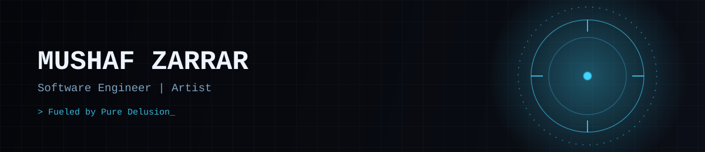

  

 

Software Engineer at [Travel Vogue](https://traveloutthere.com), building native mobile apps and agentic systems. BSc Computer Science (First-Class Honours), Royal Holloway.

I grew up on Iron Man and the idea of Jarvis, an assistant that runs things rather than waiting to be asked. That is still what I build: systems that watch, decide and act on your behalf.

  
  
  

## Building

**[Noctis OS](https://github.com/MrZarrar/Noctis-OS)**
A cross-platform agentic operating environment in Rust and Tauri. It orchestrates fleets of AI agents and long-running jobs, runs on a personal server for persistent execution, and ships a mobile PWA for remote approvals and control over a private Tailscale VPN. The Jarvis I wanted as a kid, built properly.

**[LatePay Shield](https://github.com/tol518/LatePayShield)**
Built in 36 hours at the EasyA x Flare hackathon in UK Parliament, finishing top-4 out of 1,000+ applicants. Invoice disputes run on a self-hosted local model so client data never leaves our hardware, and confirmed agreements are anchored on the Flare Coston2 network as tamper-evident evidence. The model advises, the two parties and the chain decide.

**[glycolens](https://github.com/MrZarrar/glycolens)**
A weekly pattern finder for my own insulin pump and CGM data. I have been Type 1 diabetic since I was 8, so this is a problem I live with, built to surface the patterns I need to adjust ratios before they become bad weeks.

**[Asset Repository System](https://github.com/MrZarrar/Asset-Repository---Team-Project)**
A full-stack IT asset tracker built for a real client with a team of six at Royal Holloway. I started as a regular contributor. By the time we shipped, the team was routing most technical decisions through me.

## Stack

  

## GitHub

  
  

  <picture>
    <source media="(prefers-color-scheme: dark)" srcset="https://raw.githubusercontent.com/MrZarrar/MrZarrar/output/snake-dark.svg" />
    
  </picture>

## Elsewhere

Portfolio and digital art: [mrzarrar.github.io](https://mrzarrar.github.io) · [mrzarrar.github.io/art](https://mrzarrar.github.io/art)
